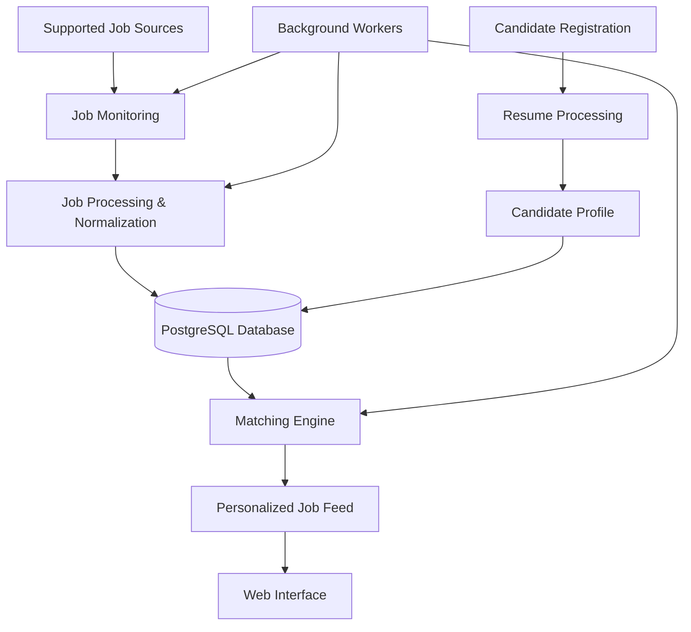

# <span style="color:#3B82F6">JobPulse</span>

### <span style="color:#8B5CF6">Intelligent Job Monitoring & Candidate Matching Platform</span>

<p align="center">
  
  
  
  
  
</p>

---

## <span style="color:#3B82F6">Overview</span>

**JobPulse** is an intelligent job monitoring and candidate matching platform designed to help job seekers discover relevant opportunities without manually checking multiple job portals.

The platform monitors supported job sources, processes new job postings, and matches opportunities against candidate profiles and preferences using an explainable matching system.

The goal is to build a system that continuously discovers opportunities and connects them with candidates based on their actual skills, experience, and career preferences.

## <span style="color:#8B5CF6">The Problem</span>

Job seekers often spend significant time:

- Checking multiple job portals and company career pages.
- Searching for opportunities that match their skills.
- Comparing job descriptions with their resumes.
- Identifying missing skills and experience requirements.
- Keeping track of newly published opportunities.

JobPulse aims to automate much of this process through job monitoring, resume analysis, and personalized matching.

## <span style="color:#16A34A">Core Features</span>

### Job Monitoring
- Monitor supported company career pages and job sources.
- Integrate with supported ATS platforms and APIs.
- Detect newly published job opportunities.
- Identify duplicate postings and job updates.
- Maintain a structured job database.

### Candidate Profiles
- User registration and account management.
- Resume upload and processing.
- Extract skills, education, experience, and projects.
- Allow users to review and update extracted information.
- Store candidate preferences and career interests.

### Intelligent Job Matching
- Compare job descriptions with candidate profiles.
- Generate percentage-based match scores.
- Identify matching skills.
- Highlight missing or unmentioned skills.
- Support user-defined priorities and preferences.

### Personalized Job Feed
- Display relevant job opportunities.
- Filter by role, location, experience, and employment type.
- Save interesting opportunities.
- Track job updates and application status.

## <span style="color:#3B82F6">System Architecture</span>

JobPulse follows a **modular monolithic architecture**. This approach keeps the initial system maintainable while allowing individual components to evolve as the platform grows.



## <span style="color:#8B5CF6">Technology Stack</span>

| Component | Technology |
|---|---|
| Backend | Python, FastAPI |
| Database | PostgreSQL |
| ORM | SQLAlchemy |
| Migrations | Alembic |
| Validation | Pydantic |
| Background Tasks | Celery |
| Message Broker / Cache | Redis |
| Frontend | HTML, CSS, JavaScript |
| Testing | Pytest |
| API Testing | Postman |
| Cloud Infrastructure | AWS (planned) |

## <span style="color:#16A34A">Project Structure</span>

```text
JobPulse/
├── app/
│   ├── api/
│   │   └── v1/
│   │       └── endpoints/
│   ├── core/
│   ├── models/
│   ├── repositories/
│   ├── schemas/
│   └── main.py
├── migrations/
├── scripts/
├── storage/
│   ├── resumes/
│   └── profile_images/
├── tests/
├── .env.example
├── .gitignore
├── alembic.ini
├── requirements.txt
└── README.md
```

## <span style="color:#3B82F6">Getting Started</span>

### Prerequisites

- Python
- PostgreSQL
- Git

### 1. Clone the repository

```bash
git clone https://github.com/thammi-mhd/JobPulse.git
cd JobPulse
```

### 2. Create a virtual environment

```bash
python3 -m venv venv
```

Activate it:

**macOS / Linux**

```bash
source venv/bin/activate
```

**Windows**

```bash
venv\Scripts\activate
```

### 3. Install dependencies

```bash
pip install -r requirements.txt
```

### 4. Configure environment variables

Create a `.env` file in the project root using `.env.example` as a reference.

Configure your PostgreSQL connection details:

```env
DB_HOST=localhost
DB_PORT=5432
DB_NAME=JobPulse
DB_USER=postgres
DB_PASSWORD=your_password
```

Do not commit your `.env` file or expose database credentials.

### 5. Run the application

```bash
uvicorn app.main:app --reload
```

Open the API documentation:

- Application: `http://127.0.0.1:8000`
- Swagger UI: `http://127.0.0.1:8000/docs`
- Health Check: `http://127.0.0.1:8000/health`

### 6. Run tests

```bash
pytest -v
```

## <span style="color:#F59E0B">Development Roadmap</span>

### Phase 1 — Backend Foundation
- [x] FastAPI application setup
- [x] PostgreSQL integration
- [x] SQLAlchemy configuration
- [x] Initial database models
- [x] Repository pattern
- [x] Initial CRUD operations
- [x] Automated tests

### Phase 2 — Authentication & User Management
- [ ] Secure password hashing
- [ ] JWT authentication
- [ ] User authorization
- [ ] Profile management

### Phase 3 — Resume Processing
- [ ] Resume upload
- [ ] PDF and DOCX parsing
- [ ] Skill and experience extraction
- [ ] Structured candidate profiles

### Phase 4 — Job Monitoring
- [ ] Job source integrations
- [ ] Automated monitoring
- [ ] Job normalization
- [ ] Duplicate detection
- [ ] Change detection

### Phase 5 — Matching Engine
- [ ] Skill-based matching
- [ ] Explainable scoring system
- [ ] Candidate preference weighting
- [ ] Personalized recommendations

### Phase 6 — Background Processing
- [ ] Redis integration
- [ ] Celery workers
- [ ] Scheduled monitoring
- [ ] Notification system

### Phase 7 — Frontend & Deployment
- [ ] Web interface
- [ ] User dashboard
- [ ] Job feed
- [ ] AWS deployment
- [ ] Monitoring and logging

## <span style="color:#8B5CF6">Engineering Principles</span>

- Modular and maintainable architecture.
- Separation of API, business logic, and data access.
- Secure handling of user information and uploaded files.
- Automated testing and validation.
- Explainable matching rather than opaque scores.
- Responsible integration with supported job sources.

## <span style="color:#3B82F6">Project Status</span>

**Currently in active development.**

JobPulse is being developed incrementally, starting with the backend foundation and database layer. Job monitoring, resume processing, matching, and cloud deployment are planned stages.

The project initially focuses on supported integrations and permitted data sources rather than unrestricted scraping of job platforms.

---

## <span style="color:#16A34A">Author</span>

**Mahammad Thameez**

- GitHub: [@thammi-mhd](https://github.com/thammi-mhd)

---

<p align="center">
  <strong>JobPulse — Discover opportunities. Match your potential.</strong>
</p>